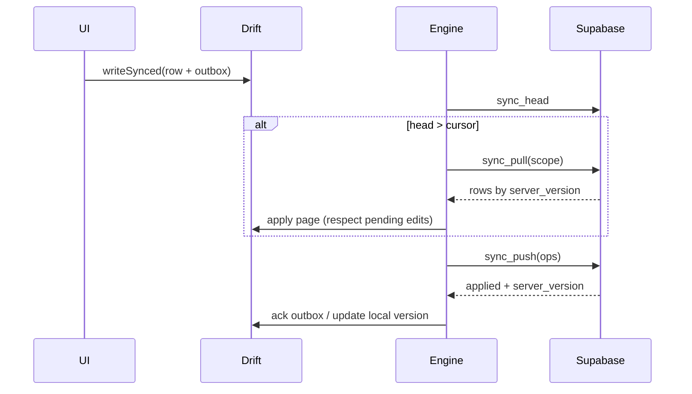
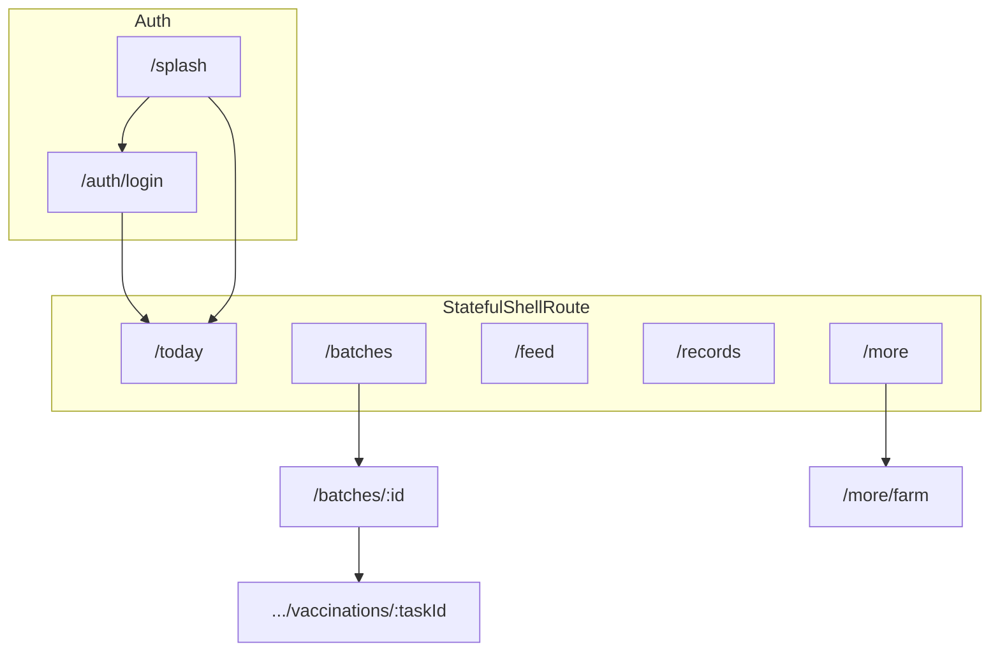

# CucoCare architecture

Android-only, offline-first poultry farm management for smallholder farmers in Uganda.

## Layers

Feature-first clean architecture:

- **Presentation** — Flutter widgets, Riverpod providers, `go_router`.
- **Domain** — pure Dart entities, repository interfaces, use-cases.
- **Data** — Drift repositories, mappers, outbox writes.

Dependencies point inward: presentation → domain ← data.

## Local source of truth

All UI reads and writes go to **SQLite via Drift**. No screen calls the network directly.

Repositories persist to Drift only. Mutations on synced tables enqueue an **outbox** row in the same transaction for delta sync.

## Offline session

- Supabase Auth session is persisted with **encrypted** `flutter_secure_storage` (`SecureLocalStorage`).
- An **AuthSnapshot** row in Drift records the signed-in user and farm membership for routing.
- Routing does **not** depend on live token refresh. If a snapshot exists, the app opens in an authenticated, offline-capable state.
- Users are never signed out because of network errors—only on explicit sign-out or explicit refresh rejection **while online**.
- **First login/registration requires connectivity** (no initial snapshot without a successful online auth).
- `offlineGraceDays` (default 30, via `Env`) limits premium checks and sync after long offline periods; local record keeping continues.

## Sync

Server versions are **per scope** (farm id or `reference`), commit-ordered via `sync_counters` (see ADR 006). Clients store one cursor per scope in Drift.

- **Bootstrap:** `sync_bootstrap()` → memberships, farms, scope heads, epoch.
- **Reachability:** `sync_head(scopes)` (not `connectivity_plus` alone).
- **Push:** leased outbox batch → `sync_push(p_ops)` → per-op results with authoritative rows.
- **Pull:** `sync_pull(scope, since, limit)` → single version-ordered stream across tables; skip pull when head == cursor.
- **Outbox:** `SyncedWrite` + coalescing, leases, dead-letter (`failed`), epoch reset without dropping unsynced ops.
- **Triggers:** foreground, connectivity regained, debounced writes, Workmanager (best effort).



| Kind | Conflict policy |
|------|-----------------|
| `mutable` | Server LWW by commit-ordered version; `farm_id` immutable after insert |
| `append_only` | Insert only; duplicate id is no-op |
| `vaccination_tasks.status` | Monotonic rank (done beats pending) |
| Pending local edit | Pull does not overwrite; push ack wins |

## Running locally

```bash
cp env/dev.example.json env/dev.json   # fill Supabase URL + anon key
flutter pub get
dart run build_runner build
flutter run --flavor dev --dart-define-from-file=env/dev.json
```

Supabase backend:

```bash
supabase start
supabase db reset   # applies migrations + seed
```

## Navigation

Five-tab `StatefulShellRoute` (Today, Batches, Feed, Records, More). Auth lives outside the shell (`/splash`, `/auth/*`). Drill-down routes use the root navigator and hide the bottom bar.



| Action | API |
|--------|-----|
| Drill-down / create | `TypedRoute(...).push(context)` |
| Auth, tab root, deep link | `TypedRoute(...).go(context)` or `router.go` |
| Return | `context.pop()` |

**Back (Android):** pop stack → non-Today tab root goes to Today → Today root exits. Router is created once; auth updates use `refreshListenable` (ADR 010).

Deep links and notification paths are handled by `DeepLinkHandler` after `hasAuthSnapshotProvider` resolves. Register `cucocare://app` on Android; unsigned users get `/auth/login?from=`.

## Vaccination

Programmes are seeded from `assets/seed/uganda_poultry_vaccination_schedule.json` on first launch. Domain rules:

- Store **dates**, compute age at read time with injected `Clock` and `Africa/Kampala` calendar days.
- Hatchery steps → `assumed_done` (confirm at hatchery, no reminders).
- Steps before registration age → `assumed_done` for farmer confirmation.
- Optional steps off by default; recurring steps generate tasks within a rolling horizon.
